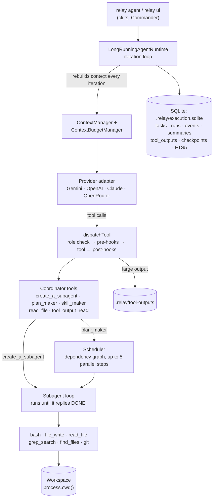

# Relay


Relay is a terminal coding agent for tasks that outlast one model context. You describe the work in plain English. A coordinator model breaks it down and delegates to subagents, which run shell, file, and git tools in your current directory. Every step is written to a local SQLite store, and each model call is rebuilt from bounded context instead of the full transcript, so a task can survive a restart and resume with `--task-id`.

It talks to Google Gemini, OpenAI, Anthropic Claude, and OpenRouter.

Source: [github.com/deepanshuliv/terminal-harness](https://github.com/deepanshuliv/terminal-harness)

## Tech stack

| Area | What the code uses |
|---|---|
| Runtime and language | [Bun](https://bun.sh), TypeScript |
| CLI | [Commander.js](https://github.com/tj/commander.js) |
| Providers | `@google/genai`, `openai`, `@anthropic-ai/sdk`. OpenRouter goes through the `openai` SDK. |
| Storage | `bun:sqlite` with an FTS5 full-text index |
| Tests | `bun test` for the CLI, pytest for the Harbor benchmark adapter |
| Formatting | Prettier |

## Requirements

- Bun. CI runs on Bun 1.3.13.
- An API key for one of the supported providers.

## Installation

```bash
bun install

# Optional: put the `relay` command on your PATH
bun link
```

If you skip `bun link`, run `bun run cli.ts` wherever this README says `relay`.

## Configuration

Log in to a provider and pick a model. The provider name is `google`, `openai`, `claude`, or `openrouter`.

```bash
relay providers login -p google -a <YOUR_API_KEY>
relay models ls
relay models set -m gemini-3.5-flash
```

`relay models ls` prints the models for every provider. `relay providers set` switches the active provider and `relay providers logout` removes one.

The key and model are saved to `database.json` in the directory where you run the command. Relay writes that file with owner-only permissions (`0600`) and prints only a masked key, but the key is stored unencrypted. Keep `database.json` out of shared directories.

For CI, containers, and other unattended runs, use environment variables instead. Nothing gets written to disk.

| Variable | Purpose |
|---|---|
| `RELAY_PROVIDER`, `RELAY_MODEL` | Provider (`google`, `openai`, `claude`, `openrouter`) and model id. Without `RELAY_MODEL`, Relay uses the provider's first listed model. |
| `GEMINI_API_KEY`, `OPENAI_API_KEY`, `ANTHROPIC_API_KEY`, `OPENROUTER_API_KEY` | API key for the selected provider |
| `RELAY_STATE_DIR` | Where the SQLite store, tool outputs, and checkpoints go (default `.relay`) |
| `RELAY_COMMAND_TIMEOUT_MS` | Timeout for shell and git commands (default `180000`) |
| `RELAY_AUTO_APPROVE` | `1` skips the delete confirmation prompt |
| `RELAY_MAX_OUTPUT_TOKENS`, `RELAY_RETRY_ATTEMPTS` | OpenRouter completion cap (default `8192`) and retry attempts (default `10`) |
| `OPENROUTER_BASE_URL`, `RELAY_USAGE_LOG` | OpenRouter endpoint, and a file that gets one line of metadata per model request |
| `NO_COLOR` | Turn off terminal colors |

## Quick start

Run one task and exit:

```bash
relay agent -p "Search for all instances of console.log and remove them"
```

Or open the interactive prompt, which asks for another task when the current one finishes:

```bash
relay ui
```

Both commands take the same options:

| Option | Default | What it does |
|---|---|---|
| `--task-id <id>` | | Resume a saved task |
| `--context-tokens <n>` | `32000` | Context capacity Relay plans each model call around |
| `--max-iterations <n>` | `500` | Upper limit on model and tool iterations |
| `--verify` | off | Run the project's checks before the task can be marked complete |

Before a shell command deletes files (`rm`, `rmdir`, `unlink`, `shred`, `find -delete`, `git clean -f`, also behind `sudo`, `xargs`, or `&&`), Relay asks you to confirm with `y/N`. Set `RELAY_AUTO_APPROVE=1` only in a disposable environment.

The `Dockerfile` builds an image with Bun and git whose entrypoint is the CLI and whose working directory is `/workspace`.

## Architecture



### A run, step by step

1. `relay agent` loads the session from `RELAY_PROVIDER` or `database.json`, then creates a task in SQLite or loads it with `--task-id`.
2. Each iteration rebuilds the model's context from bounded parts: system and project instructions, the typed task state, the latest summary, selected events, history pulled from the FTS5 index, and the current input. When the budget runs low, `CompactionManager` writes a new versioned summary. If summarizing fails, it rebuilds from the task state instead.
3. The coordinator gets five tools: `create_a_subagent`, `plan_maker`, `skill_maker`, `read_file`, and `tool_output_read`. It never runs a shell itself. `dispatchTool` checks every call against the caller's role, and that includes steps inside a `plan_maker` plan, so a plan can't hand the coordinator a shell.
4. A subagent uses the session's provider and model. It can call `bash` (`zsh` is an alias), `file_write`, `read_file`, `grep_search`, `find_files`, `git`, `tool_output_read`, and `plan_maker`. It keeps going until it replies with `DONE:` and no tool call. Subagents can't start other subagents.
5. `plan_maker` takes steps with `dependsOn` ids. The scheduler starts the steps that have no unmet dependencies, up to 5 at a time, and queues the rest until their dependencies finish.
6. Small tool output stays in the conversation. Large output goes to `.relay/tool-outputs`, and the model reads it back in ranges with `tool_output_read`.
7. When the coordinator answers without a tool call, the run ends. With `--verify`, Relay first runs whichever of the workspace's `typecheck`, `lint`, `test`, `build`, and `format:check` scripts exist in `package.json`. If one fails, the failure is saved and the run carries on to fix it.

Bad tool arguments, unknown tools, and failed commands come back to the model as error messages. A provider error (rate limit, payment, server error) stops the run.

### Terminal UI

The UI shows only what happened: commands, trimmed results, context rebuilds, verification, and status changes. There's no spinner, and model reasoning isn't printed. Colors and the live status line appear only on a TTY. Piped output is plain text.

## Benchmark

[`benchmark/`](benchmark/README.md) runs Relay against mini-swe-agent on Terminal-Bench 2.0 tasks through Harbor, with the same model, dataset, and Docker setup for both. On a 5-task held-out set, Relay passed 4 and mini-swe-agent passed 3, while using more requests and time. The report treats a 1-task gap as within run-to-run noise. See [`benchmark/results/REPORT.md`](benchmark/results/REPORT.md) for the per-task results and how they were measured.

## Development

```bash
bun run format:check
bun run typecheck
bun test
bun run build
```

`bun run format` fixes formatting. The test suites in `tests/` cover task state and restarts, context budgets, compaction and retrieval, tool argument validation, role-scoped tools, the delete check, and OpenRouter retries and usage logging.

CI (`.github/workflows/ci.yml`) runs the four commands above on every push to `main` and every pull request. It also runs the Harbor adapter tests:

```bash
uv run --python 3.13 --with harbor==0.23.0 --with pytest pytest -c benchmark/pytest.ini --rootdir benchmark benchmark/tests -q
```

## Limitations

- `database.json` is tied to the directory you run Relay in, and keys in it are not encrypted.
- Token counts come from a conservative character-based estimate. You can plug in a provider tokenizer through `TokenEstimator`.
- Without `--verify`, a finished run leaves the task unverified instead of marking it complete.
- Checkpoints record git metadata and binary diffs. Relay does not restore the workspace from them automatically.
- Shell and git commands time out after 180 seconds by default. Start long jobs in the background and poll them.
- The delete check matches command words and is not a shell parser. It sometimes asks about quoted strings that only look like separators, and it misses some destructive commands, such as `dd` or `mv` over an existing file.
- File writes are serialized with an in-memory lock, so the protection only holds within one Relay process.
